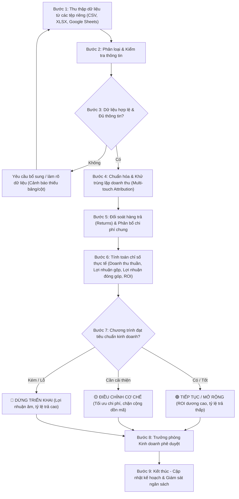

# BÁO CÁO ĐỒ ÁN MÔN HỌC: AI301 - AI AGENT
## ĐỀ DỰ ÁN 08: ĐÁNH GIÁ HIỆU QUẢ CHƯƠNG TRÌNH BÁN HÀNG — CÔNG TY GIA HÒA

---

## 1. TỔNG QUAN BÀI TOÁN NGHIỆP VỤ

### 1.1. Bối cảnh doanh nghiệp
Công ty **Gia Hòa** là doanh nghiệp bán lẻ đồ dùng gia đình (nồi inox, chảo chống dính, nồi chiên không dầu, máy xay sinh tố, kệ bếp...) qua hai kênh: **Cửa hàng vật lý** và **Kênh trực tuyến**. Trong một tháng cao điểm, công ty triển khai đồng thời **4 chương trình bán hàng**:
1. **CT01 — Combo Bếp Ấm Gia Hòa:** Mua theo bộ sản phẩm nhà bếp giảm 12%.
2. **CT02 — Flash Deal Siêu Sale 30%:** Giảm giá trực tiếp 30% trên kênh trực tuyến vào khung giờ vàng.
3. **CT03 — Đặc Quyền Thành Viên Gia Hòa:** Tặng mã Voucher giảm thêm 100.000đ – 300.000đ (hoặc 10%) cho khách hàng thân thiết có đơn từ 800.000đ.
4. **CT04 — Tuần Lễ Đổi Cũ Lấy Mới:** Trợ giá 15% và tặng quà khi khách mang đồ gia dụng cũ tới hệ thống cửa hàng.

### 1.2. Ba điểm nghẽn cốt lõi trong báo cáo thủ công hiện tại
1. **Trùng lặp doanh thu (Double-Counting Revenue):** Một đơn hàng có thể áp dụng chồng (stacking) nhiều chương trình (ví dụ: Đơn `DH009` mua Nồi chiên không dầu vừa được giảm 30% từ **CT02**, vừa áp thêm mã thành viên 300.000đ của **CT03**). Khi tổng hợp báo cáo riêng lẻ, nhân viên phụ trách CT02 và nhân viên phụ trách CT03 đều tính 100% doanh thu đơn `DH009` (`8.100.000đ`) vào thành tích chương trình của mình.
2. **Bỏ sót hàng trả sau chương trình (Ignored Post-Campaign Returns):** Các đợt sale sập sàn (như CT02) kích thích mua hàng xung động dẫn đến tỷ lệ trả hàng và móp méo khi vận chuyển rất cao sau khi chương trình đã kết thúc, nhưng báo cáo doanh thu không hề khấu trừ khoản hoàn tiền cũng như chi phí xử lý/hư hỏng hàng hoàn.
3. **Phân bổ chi phí chung thiếu nhất quán (Inconsistent Shared Cost Allocation):** Khoản chi phí chung của chiến dịch tháng (`20.000.000đ` gồm Marketing thương hiệu và Vận hành đóng gói) bị phân bổ cảm tính, dẫn đến không xác định được **Lợi nhuận đóng góp ròng (Net Contribution Margin)** và **ROI thực tế** của từng chương trình.

---

## 2. KIẾN TRÚC QUY TRÌNH XỬ LÝ CỦA AI AGENT (WORKFLOW 9 BƯỚC)

Hệ thống AI Agent được thiết kế bám sát sơ đồ quy trình chuẩn của Công ty Gia Hòa:

---

## 3. MÔ HÌNH TOÁN HỌC & QUY TẮC TÍNH TOÁN TRONG AI AGENT

### 3.1. Công thức Khử trùng lặp Doanh thu (Bước 4)
Giả sử đơn hàng $i$ có tổng giá trị niêm yết $G_i$, tiếp xúc với tập chương trình $P_i$, trong đó mỗi chương trình $c \in P_i$ tài trợ mức giảm giá $D_{i,c}$ (với tổng giảm giá $D_i = \sum_{c \in P_i} D_{i,c}$).
Trọng số phân bổ $w_{i,c}$ của chương trình $c$ trên đơn hàng $i$ được tính theo quy tắc cấu hình:
- **Theo tỷ trọng mức giảm giá thực tế (`TY_TRONG_UU_DAI` - Mặc định):**
  $$w_{i,c} = \frac{D_{i,c}}{\sum_{k \in P_i} D_{i,k}}$$
- **Chia đều (`CHIA_DEU_LINEAR`):**
  $$w_{i,c} = \frac{1}{|P_i|}$$
- **First-Touch / Last-Touch:** Ghi nhận $w_{i,c} = 1$ cho chương trình có thứ tự tiếp xúc đầu tiên hoặc cuối cùng.

Khi đó, **Doanh thu sau khử trùng lặp (trước trả hàng)** của chương trình $c$ từ đơn $i$ là:
$$R^{\text{dedup}}_{i,c} = w_{i,c} \cdot G_i - D_{i,c}$$
*(Đảm bảo tổng doanh thu phân bổ cho mọi chương trình trên đơn $i$ luôn bằng đúng số tiền thực thu của đơn hàng đó: $\sum_{c \in P_i} R^{\text{dedup}}_{i,c} = G_i - D_i$, triệt tiêu hoàn toàn doanh thu ảo).*

### 3.2. Công thức Đối soát Hàng trả & Giá vốn Thực tế (Bước 5)
- **Doanh thu thuần thực tế (Net Revenue):**
  $$\text{NetRev}_c = \sum_{i} \left( R^{\text{dedup}}_{i,c} - w_{i,c} \cdot \text{Refund}_i \right)$$
- **Giá vốn thực tế (Net COGS):**
  - Nếu hàng trả ở tình trạng `Nhap_Lai_Kho` (nguyên vẹn): Kho thu hồi lại được giá vốn của số lượng trả.
  - Nếu hàng trả ở tình trạng `Hong_Hao_Hut` (móp méo, lỗi mạch nhiệt): Công ty không thu hồi được giá vốn và phải chịu thêm phí xử lý/vận chuyển hoàn 2 chiều ($\text{ReturnFee}_i$).

### 3.3. Phân bổ Chi phí chung & Tính Lợi nhuận đóng góp, ROI (Bước 6)
- **Chi phí chung phân bổ ($\text{SharedCost}_c$):**
  $$\text{SharedCost}_c = \text{TotalSharedCost} \times \frac{\max(0, \text{NetRev}_c)}{\sum_{k} \max(0, \text{NetRev}_k)}$$
- **Tổng chi phí vận hành & marketing chương trình ($\text{CampaignCost}_c$):**
  $$\text{CampaignCost}_c = \text{DirectCost}_c + \text{SharedCost}_c$$
- **Lợi nhuận đóng góp ròng ($\text{NetContribution}_c$) và $\text{ROI}_c$:**
  $$\text{NetContribution}_c = \text{GrossProfit}_c - \text{CampaignCost}_c$$
  $$\text{ROI}_c (\%) = \frac{\text{NetContribution}_c}{\text{CampaignCost}_c} \times 100\%$$

---

## 4. KẾT QUẢ PHÂN TÍCH CHI TIẾT & ĐỀ XUẤT KINH DOANH

| Chỉ số | CT01: Combo Bếp Ấm | CT02: Flash Deal 30% | CT03: Đặc Quyền VIP | CT04: Đổi Cũ Lấy Mới |
| :--- | ---: | ---: | ---: | ---: |
| **Số đơn tiếp xúc (Đơn trùng)** | 9 đơn (3 trùng) | 7 đơn (4 trùng) | 13 đơn (8 trùng) | 6 đơn (2 trùng) |
| **DT Báo cáo cũ (Tính trùng)** | 50.418.000 đ | 49.260.000 đ | 76.960.000 đ | 35.145.000 đ |
| **DT Ảo do tính trùng** | -4.156.929 đ | -3.021.116 đ | -41.762.098 đ | -1.487.857 đ |
| **Hàng trả (% Tỷ lệ trả)** | -792.000 đ (1.7%) | -12.375.948 đ (26.8%) | -1.551.345 đ (4.4%) | -382.500 đ (1.1%) |
| **Doanh thu thuần thực tế** | **45.469.071 đ** | **33.862.936 đ** | **33.646.557 đ** | **33.274.643 đ** |
| **Giá vốn thực tế & Phí hoàn** | 26.896.819 đ | 23.311.531 đ | 20.953.505 đ | 17.367.896 đ |
| **Lợi nhuận gộp** | **18.572.252 đ** | **10.551.405 đ** | **12.693.052 đ** | **15.906.747 đ** |
| **Chi phí trực tiếp** | 6.500.000 đ | 14.500.000 đ | 4.200.000 đ | 8.800.000 đ |
| **Chi phí chung phân bổ** | 6.217.858 đ | 4.630.758 đ | 4.601.168 đ | 4.550.309 đ |
| **Lợi nhuận đóng góp ròng** | **+5.854.394 đ** | **-8.579.353 đ** | **+3.891.884 đ** | **+2.556.438 đ** |
| **ROI Thực tế (%)** | **+46.0%** | **-44.8%** | **+44.2%** | **+19.1%** |
| **Đề xuất của AI Agent** | 🟢 **TIẾP TỤC / MỞ RỘNG** | 🔴 **DỪNG TRIỂN KHAI** | 🟡 **ĐIỀU CHỈNH CƠ CHẾ** | 🟡 **ĐIỀU CHỈNH CƠ CHẾ** |

---

## 5. KỊCH BẢN DEMO NHANH TRÊN LOCALHOST (`http://localhost:8080`)

1. **Bước 1 (Giới thiệu bài toán & Workflow):** Mở http://localhost:8080, bấm nút **"🖼️ Ẩn/Hiện Ảnh Sơ Đồ Workflow Gốc"** để đối chiếu sơ đồ 9 bước với giao diện hệ thống.
2. **Bước 2 (Demo Kiểm tra dữ liệu & Nhánh lỗi màu đỏ):** Bấm nút **"⚠️ Test Nhánh Lỗi Dữ Liệu"** trên góc phải để trình diễn khả năng phát hiện thiếu bảng *Đổi trả hàng* & *Giá vốn*, hệ thống tự động chặn tính toán sai và yêu cầu bổ sung. Sau đó bấm **"🔄 Khôi phục đủ 5 tệp chuẩn"**.
3. **Bước 3 (Demo Đầu vào File CSV/XLSX & Google Sheets):**
   - Bấm **"📥 Tải Bộ File Mẫu (.XLSX)"** để tải file Excel 5 sheet về máy, kéo thả lại vào khung Upload để chứng minh Agent tự động phân loại 5 bảng.
   - Chuyển sang tab **"🔗 Dán Link Google Sheets"** để minh họa khả năng kết nối trực tiếp Google Sheets qua backend proxy.
4. **Bước 4 (Giải trình Kết quả & Mô phỏng What-If):**
   - Chỉ vào thẻ **CT02 (Flash Deal 30%)** màu đỏ: Giải thích vì sao doanh thu báo cáo gần 50 triệu nhưng thực tế lỗ `-8.58 triệu VNĐ` (ROI `-44.8%`).
   - Bấm vào tab **"🎛️ 4. Mô Phỏng Kịch Bản Tối Ưu (What-If Simulator)"** và kéo thanh trượt để xem cần giảm chiết khấu và tỷ lệ hoàn trả bao nhiêu thì CT02 mới hết lỗ.
5. **Bước 5 (Trưởng phòng Phê duyệt & Hỏi đáp Chat AI Agent):**
   - Bấm **"💾 Phê Duyệt Kế Hoạch"** ở Bước 8 & 9 và đặt câu hỏi trong khung **Trợ Lý AI Agent Giải Trình Kết Quả**.

